<div align="center">

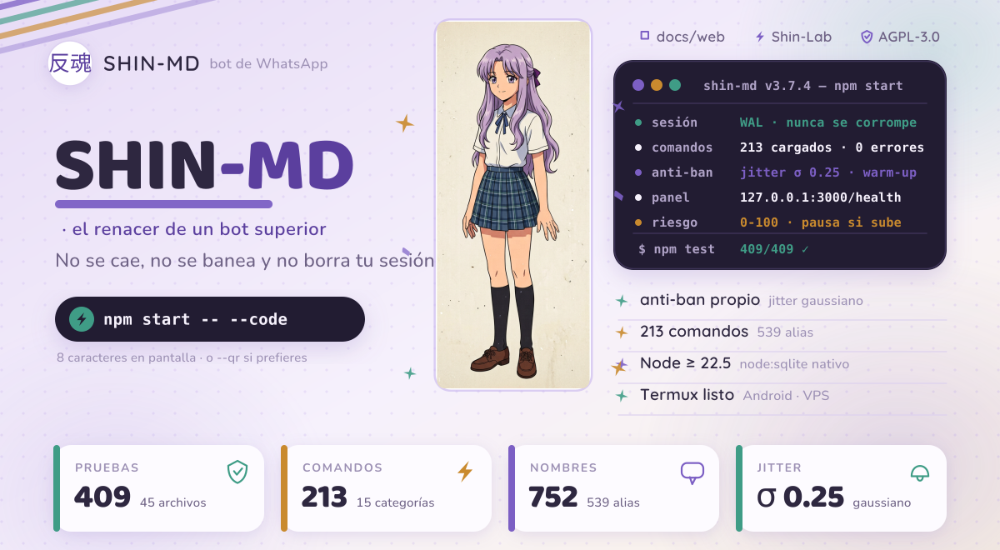

<br>


<br><br>

<!-- El único recurso externo del README: el badge del CI, porque su estado
     cambia en cada push. Si quieres cero peticiones a terceros, borra esta línea. -->
[](https://github.com/riokuroxi-svg/Shin-MD/actions)

**El bot de WhatsApp que sobrevive a los cortes de red, no pierde tu sesión
y reduce el riesgo de bloqueo.**

212 comandos · anti-ban nativo · Node ≥ 22.5 · sin servicios de terceros en medio.

_Reducir el riesgo no es eliminarlo: eso lo decide WhatsApp, no el bot. Lo que sí está en nuestra mano está contado en [el anti-ban por dentro](#el-anti-ban-por-dentro)._

[🌐 Página del proyecto](docs/web/index.html) ·
[⚡ Instalar](#instalación-en-5-minutos) ·
[🧩 Comandos](#los-212-comandos) ·
[🛡️ Anti-ban](#el-anti-ban-por-dentro) ·
[🪪 Identidades](#identidades-lid) ·
[🔌 El conector](#el-conector) ·
[📜 Licencia](#licencia-y-marca) ·
[🧪 Shin-Lab](https://github.com/riokuroxi-svg/Shin-Lab)

</div>

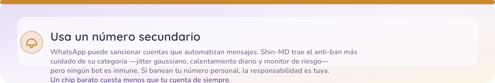

<h2 id="lo-que-lo-hace-distinto">Lo que lo hace distinto</h2>


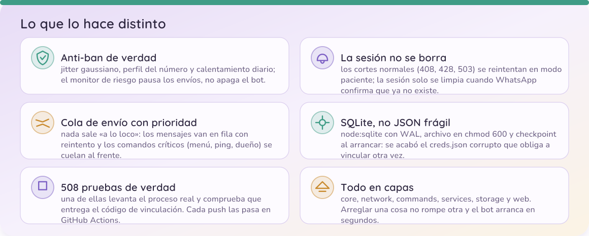

<h2 id="el-anti-ban-por-dentro">El anti-ban por dentro</h2>

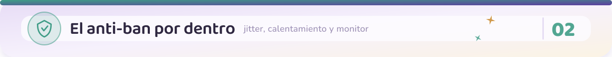

Nada de «espero un `Math.random()`». Esto es lo que hace que el bot parezca una
persona y se proteja solo:

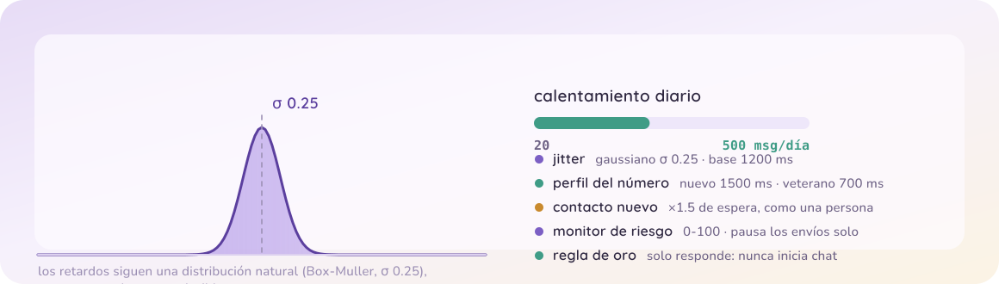

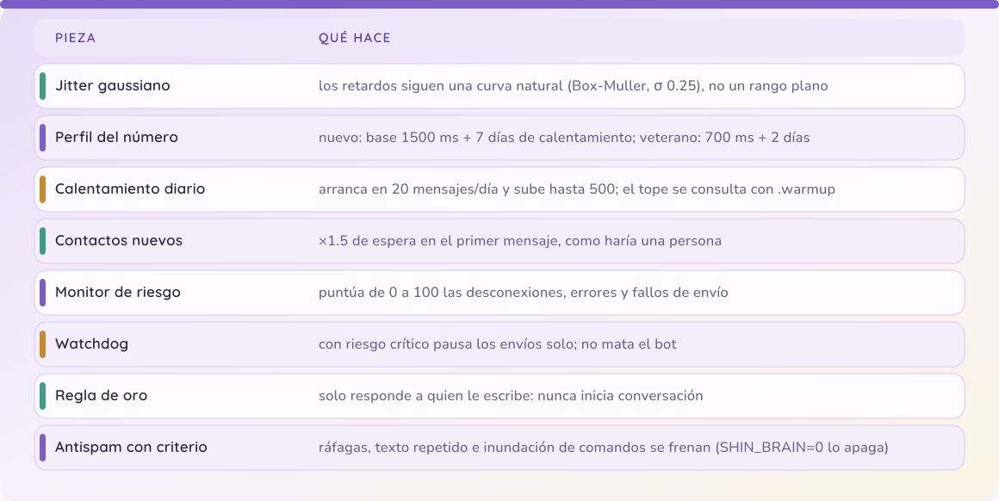

**Lo que esto consigue y lo que no.** Estas piezas están en el código y se pueden
leer: riesgo medido por el watchdog (a 80 se pausa la cola de envíos, a 95 se
reconecta), jitter gaussiano entre mensajes, calentamiento diario, límite por
comando y sesión que no se borra por un corte de red. Ninguna de ellas puede
prometer que WhatsApp no suspenda una cuenta: eso lo decide WhatsApp con
señales que el bot no ve. Lo que sí se puede decir es que el bot no se
comporta como un robot que dispara mil mensajes por minuto. **Usa un número
secundario.**

<details>
<summary><b>Huella de Shin-MD (marcador de obras derivadas)</b></summary>

El motor anti-ban tiene una combinación de parámetros propia:

`shinJitter` gaussiano σ 0.25 · base **1200 ms** (400–5000, +25 ms por carácter)
· perfil nuevo **1500 ms** / veterano **700 ms** · penalización **×1.5** a
contactos nuevos · calentamiento **20→500** mensajes/día en **7 días**

Si ves esos parámetros exactos en otro bot, es una obra derivada de Shin-MD y
debe cumplir la atribución de la Sección 7 del `NOTICE`.

</details>

<h2 id="los-212-comandos">Los 212 comandos</h2>

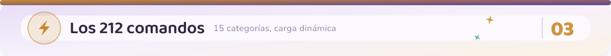

Escribe `.menu` dentro de WhatsApp y verás la tarjeta con botones y la lista
desplegable por categorías.

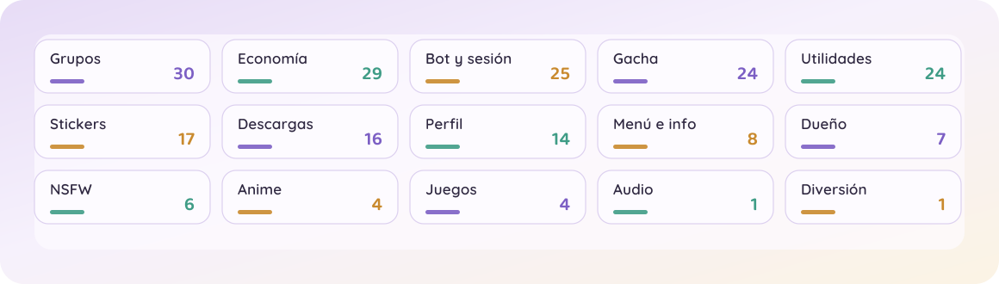

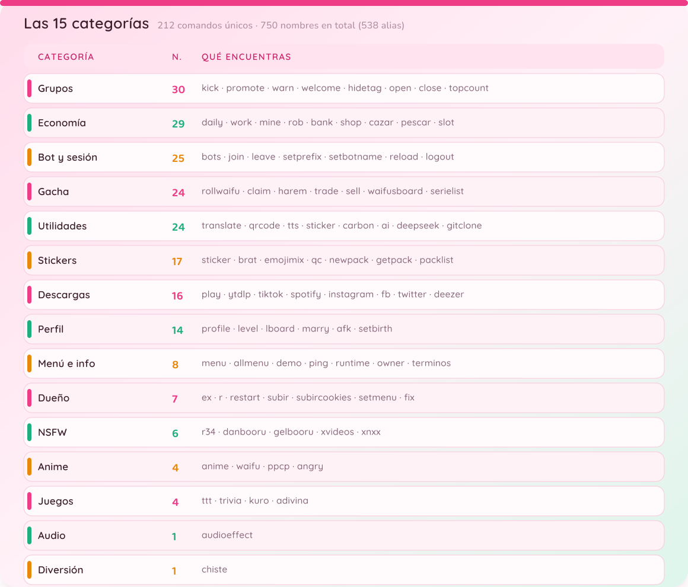

**212 comandos únicos · 750 nombres en total (538 alias) · 15 categorías.** Nombres de
ejemplo: `.play` (y sus alias `yt`, `mp3`, `musica`), `.sticker` (`s`),
`.daily` (`diario`, `recompensa`), `.w` (`work`, `trabajar`), `.x` para Twitter,
`.ig` para Instagram y `.menu` (`ayuda`, `h`).

🔑 *Instagram y Pinterest usan `FASTSAVER_KEY` (gratis en api.fastsaver.io).
Twitter funciona sin clave, pero es más estable con ella.*

<details>
<summary><b>Ver la lista completa de comandos (se genera del propio bot)</b></summary>

La página **[docs/web/index.html](docs/web/index.html)** lleva los 212 con su
buscador, filtros por categoría y descripción. Para regenerarla cuando añadas
comandos:

```bash
npm run docs:web
```

</details>

<h2 id="panel-local">Panel local</h2>


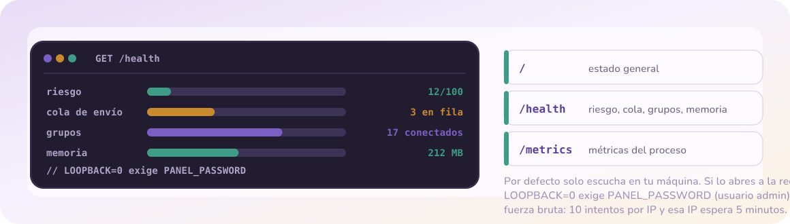

<h2 id="instalación-en-un-comando">Instalación en un comando</h2>


**Android (Termux).** Instala Termux desde [F-Droid](https://f-droid.org/packages/com.termux/)
—la versión de Play Store está abandonada y rompe los paquetes— y pega esto:

```bash
pkg update -y && pkg install -y curl
curl -fsSL https://raw.githubusercontent.com/riokuroxi-svg/Shin-MD/v3.2.4/install.sh -o install.sh
curl -fsSL https://raw.githubusercontent.com/riokuroxi-svg/Shin-MD/v3.2.4/SHA256SUMS -o SHA256SUMS
sha256sum -c SHA256SUMS && bash install.sh --version v3.2.4
```

La cuarta línea solo ejecuta si la huella coincide: instala una versión
concreta, no lo que haya en `main` ese día.

El instalador mira la versión de Node, instala lo que falte con `pkg`, descarga
Shin-MD en `~/Shin-MD`, instala las dependencias, deja los ocho parches del
conector puestos y comprueba que todo esté sano. Si ya tenías una instalación,
**actualiza en vez de duplicar**, y nunca toca `.env`, `Sessions/` ni `data/`.

Antes de arrancarlo, para que Android no lo mate mientras duerme:

1. Notificación de Termux → **Acquire wakelock**.
2. Ajustes → Batería → Termux → **Sin restricciones**.
3. Android 14 o más: Opciones de desarrollador → **Desactivar restricciones de procesos hijos**.

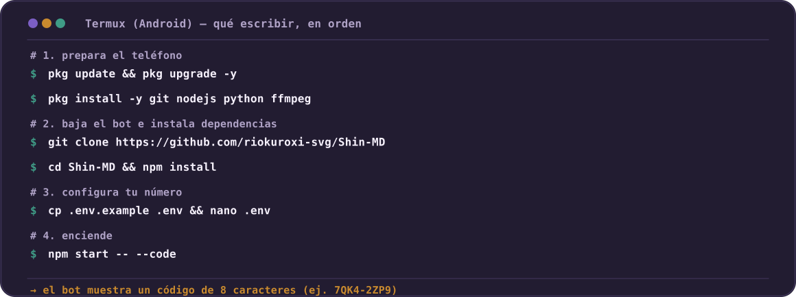

En WhatsApp: **Dispositivos vinculados → Vincular con número de teléfono**.
¿Prefieres QR? `npm start -- --qr`.

**Servidor o VPS.** Los mismos comandos, con Node 22.5 o superior instalado:

```bash
curl -fsSL https://raw.githubusercontent.com/riokuroxi-svg/Shin-MD/v3.2.4/install.sh -o install.sh
curl -fsSL https://raw.githubusercontent.com/riokuroxi-svg/Shin-MD/v3.2.4/SHA256SUMS -o SHA256SUMS
sha256sum -c SHA256SUMS && bash install.sh --version v3.2.4
cd ~/Shin-MD && npm start
```

**Ya instalado.** Un solo archivo manda sobre todo:

| Quiero… | Comando |
|---|---|
| actualizar conservando mi sesión | `bash ~/Shin-MD/install.sh --update` |
| arreglar una instalación rota | `bash ~/Shin-MD/install.sh --repair` |
| saber si todo está bien | `bash ~/Shin-MD/install.sh --verify` |
| desinstalar y guardar mis datos | `bash ~/Shin-MD/install.sh --uninstall` |

Por qué se descarga y luego se ejecuta, en lugar de `curl … | bash`: así puedes
leerlo antes de correrlo, y si falla a mitad sabes qué archivo estaba haciendo qué.
[Guía completa de Termux](docs/TERMUX.md) · [Instalador y recuperación](docs/INSTALACION.md) ·
[Auditoría de seguridad](docs/AUDITORIA-3.2.1.md)


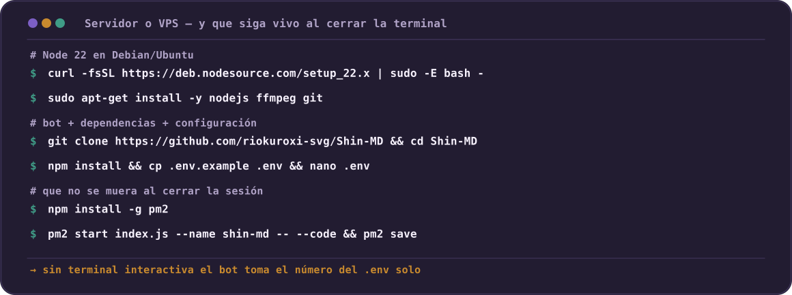

<h2 id="cómo-está-hecho">Cómo está hecho</h2>


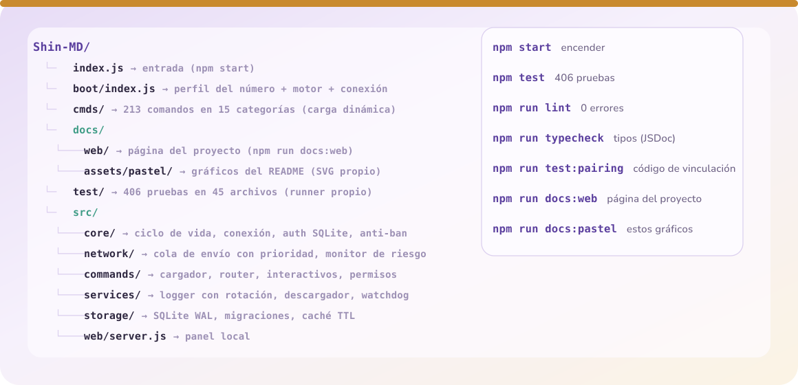

<details>
<summary><b>Regenerar los gráficos del README (trazo vectorial, sin fuentes externas)</b></summary>

Las imágenes de arriba se generan solas y leen los números reales del bot
(`docs/assets/datos.json` si está; si no, los valores de respaldo del script),
así que nunca enseñan una cifra vieja. No usan fuentes de terceros ni peticiones
a internet: el texto va convertido a **trazado vectorial**, y así se dibuja
idéntico en cualquier móvil o navegador.

```bash
npm run docs:pastel        # o directamente: python3 tools/build_pastel.py
```

La primera vez hace falta `python3 -m pip install fonttools cairosvg pillow`
(y `fonts-noto-cjk` en Debian/Ubuntu para el kanji 反魂).

</details>

<h2 id="el-conector">El conector</h2>

El bot habla con WhatsApp a través de Baileys, y Baileys no está en su mejor
momento: la última versión es de julio y el proyecto lleva meses sin publicar,
con 46 arreglos esperando en la cola. En vez de esperar, el `npm install` aplica
un juego de parches propios —idempotentes, verificados y con su issue de
origen— que cubren lo que duele de verdad:

- **Vinculación**: QR que caduca, código que el teléfono rechaza por un nonce
  mal puesto y reconexión que manda el nodo equivocado.
- **Reconexiones**: los estados llegan como `<status>` y sin ack el servidor
  corta el stream cada ~50 minutos.
- **Multimedia**: una URL caducada ya no deja el archivo sin descargar; se pide
  el reenvío.
- **Memoria**: una fuga de `AsyncLocalStorage` por socket que crecía en cada
  reconexión.

Lo que no se puede arreglar (y por qué) también está escrito, con las 1 662
incidencias revisadas y su estado. Informe completo en
**[docs/CONECTOR.md](docs/CONECTOR.md)** · detalle de LID en
**[docs/LID.md](docs/LID.md)**.

```bash
node scripts/patch-baileys.cjs --check   # ¿están los ocho parches aplicados?
```

<h2 id="identidades-lid">Identidades: LID y teléfono</h2>

WhatsApp puede mandar al mismo usuario de dos formas: con su teléfono
(`521…@s.whatsapp.net`) o con un identificador interno, el **LID**
(`123…@lid`). Son **la misma persona**. Si el bot los tratara como dos, cada
usuario tendría dos carteras, el dueño dejaría de ser dueño y el admin de un
grupo dejaría de ser admin porque "no coincide el número".

Este bot los une:

- La llave de la economía es el **teléfono** siempre que se conozca, así los
  datos que ya estaban guardados siguen cuadrando.
- La pareja LID ↔ teléfono se aprende de donde venga (mensajes, metadatos del
  grupo, avisos del conector) y se guarda en SQLite: **sobrevive a reinicios y
  cambios de sesión**.
- El conector (Baileys 7) también guarda esas parejas en su propia sesión, así
  que «¿de quién es este LID?» se contesta **sin salir a internet**.
- Si alguien escribió cuando solo se conocía su LID, sus monedas se **fusionan**
  con la cuenta del teléfono en cuanto la pareja se aprende.
- Los permisos (dueño, admins) comparan las dos caras y la regla mexicana
  `521 = 52`, no cadenas de texto.

Lo que **no** se puede hacer, y conviene decirlo: saber el teléfono de un LID
que nadie vio nunca. Se contesta con lo aprendido por el conector y por el
tráfico; la consulta inversa (teléfono → LID) sí existe, pero sale a internet y
solo se usa cuando se pide a propósito con `.lid`.

Pruébalo en el teléfono con `.lid`: muestra tu llave, tu teléfono, tu LID, lo
que sabe el conector y si el bot ya conoce la pareja. En un grupo y en privado debes ver **la misma
llave**. Detalle técnico en **[docs/LID.md](docs/LID.md)**.

<h2 id="el-laboratorio">El laboratorio</h2>


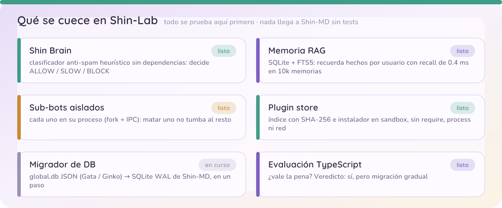

Todo lo experimental vive en [**Shin-Lab**](https://github.com/riokuroxi-svg/Shin-Lab).
**Nada migra a este repositorio sin estar probado.**

<h2 id="licencia-y-marca">Licencia y marca</h2>


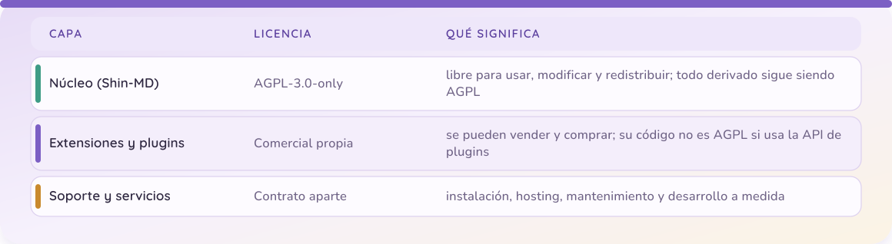

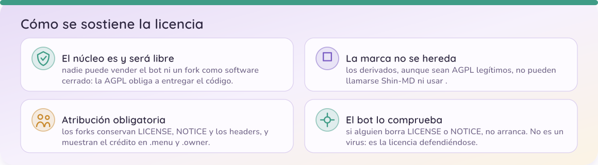

<h2 id="créditos">Créditos</h2>


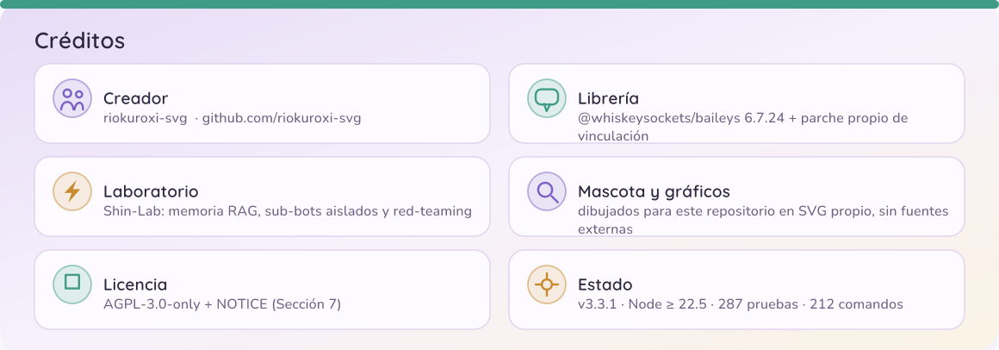

<div align="center">


</div>
