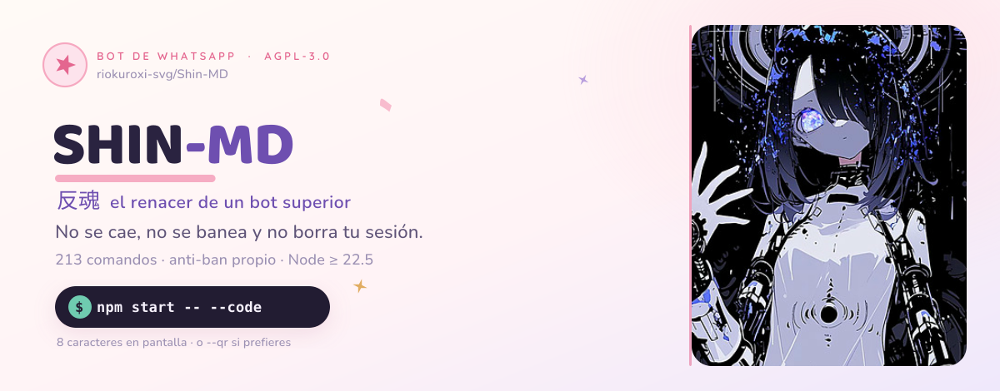
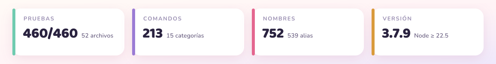

<div align="center">



<br>

<a href="https://github.com/riokuroxi-svg/Shin-MD"></a>
<a href="#instalación"></a>
<a href="#licencia-y-marca"></a>
<a href="#instalación"></a>
<a href="https://ko-fi.com/kuroxisvg"></a>

[](https://github.com/riokuroxi-svg/Shin-MD/actions)

**El bot de WhatsApp que sobrevive a los cortes de red, no pierde tu sesión
y reduce el riesgo de bloqueo.**

[Anti-ban](#el-anti-ban-por-dentro) · [Comandos](#los-comandos) ·
[Galería](#galería) · [Instalación](#instalación) · [Guías](#las-guías) ·
[Conector](#el-conector) · [LID](#identidades-lid) ·
[Licencia](#licencia-y-marca) · [Shin-Lab](https://github.com/riokuroxi-svg/Shin-Lab) ·
[Apoyar](#apoyar-el-proyecto)

</div>




<h2 id="lo-que-lo-hace-distinto">Lo que lo hace distinto</h2>

No es una lista de deseos: cada línea de abajo tiene su archivo, y su prueba.

| Lo que promete | Dónde está para leerlo |
|---|---|
| anti-ban (jitter gaussiano, perfil, calentamiento) | `src/core/engine/throttler.js` |
| cola con prioridad y reintentos | `src/network/queue.js` |
| sesión en SQLite, sin `creds.json` corrupto | `src/core/auth.js` y `src/storage/database.js` |
| el bot se reinicia solo si se cae | `scripts/supervisor.mjs` y `scripts/vigia.mjs` |
| cada afirmación con su prueba | `test/` (una prueba por cosa que se dice) |
| capas separadas: motor por un lado, comandos por otro | `src/` y `cmds/` |

_Reducir el riesgo no es eliminarlo: eso lo decide WhatsApp, no el bot. Lo que sí
está en nuestra mano está contado en [el anti-ban por dentro](#el-anti-ban-por-dentro)._

<h2 id="el-anti-ban-por-dentro">El anti-ban por dentro</h2>

Nada de «espero un `Math.random()`». Esto es lo que hace que el bot parezca una
persona y se proteja solo:


**Lo que esto consigue y lo que no.** Estas piezas están en el código y se pueden
leer: riesgo medido por el watchdog (a 80 se pausa la cola de envíos, a 95 se
reconecta), jitter gaussiano entre mensajes, calentamiento diario, límite por
comando y sesión que no se borra por un corte de red. Ninguna de ellas puede
prometer que WhatsApp no suspenda una cuenta: eso lo decide WhatsApp con
señales que el bot no ve. Lo que sí se puede decir es que el bot no se comporta
como un robot que dispara mil mensajes por minuto. **Usa un número secundario.**

<details>
<summary><b>Huella de Shin-MD (marcador de obras derivadas)</b></summary>

El motor anti-ban tiene una combinación de parámetros propia:

`shinJitter` gaussiano σ 0.25 · base **1200 ms** (400–5000, +25 ms por carácter)
· perfil nuevo **1500 ms** / veterano **700 ms** · penalización **×1.5** a
contactos nuevos · calentamiento **20→500** mensajes/día en **7 días**

Si ves esos parámetros exactos en otro bot, es una obra derivada de Shin-MD y
debe cumplir la atribución de la Sección 7 del `NOTICE`.

</details>

<h2 id="los-comandos">Los 213 comandos</h2>

Escribe `.menu` dentro de WhatsApp y verás la tarjeta con botones y la lista
desplegable por categorías.


**213 comandos únicos · 752 nombres en total (539 alias) · 15 categorías.** Nombres de
ejemplo: `.play` (y sus alias `yt`, `mp3`, `musica`), `.sticker` (`s`),
`.daily` (`diario`, `recompensa`), `.w` (`work`, `trabajar`), `.x` para Twitter,
`.ig` para Instagram y `.menu` (`ayuda`, `h`).

🔑 *`.instagram`, `.twitter` y `.imagen` funcionan solos; si quieres un plan B
cuando el método directo falla, se les puede configurar una API de respaldo en
el `.env` (`GINKO_API_URL`, `DELIRIUS_API_URL`…). Sin ella el comando lo dice y
el resto del bot no se entera. `.pinterest` está fuera de servicio: su API
gratuita cerró.*

<details>
<summary><b>Ver la lista completa de comandos (se genera del propio bot)</b></summary>

La página **[docs/web/index.html](docs/web/index.html)** lleva los 213 con su
buscador, filtros por categoría y descripción. Para regenerarla cuando añadas
comandos:

```bash
npm run docs:web
```

</details>

<h2 id="galería">Galería</h2>

El arte que acompaña al proyecto. Cada pieza está en `assets/src/perfil/` como
original y en `docs/assets/arte/` preparada para el README (supermuestreo,
paso alto suave y JPEG 4:4:4, para que el morado no se manche).

<table>
  <tr>
    <td width="33.3%"></td>
    <td width="33.3%"></td>
    <td width="33.3%"></td>
  </tr>
</table>


<h2 id="panel-local">Panel local</h2>


**Una foto del estado, sin arrancar nada.** `npm run panel` dibuja dos cajas:
una con el bot y otra con el teléfono donde corre. `npm run panel:vivir` la
refresca cada dos segundos. Es de solo lectura: no manda nada, no expone nada
hacia fuera y solo habla con `127.0.0.1`.

**Cuando un mensaje sale como «no compatible con tu versión».** Ese cartel no
lo pone el bot: lo pone tu WhatsApp cuando no entiende un tipo de mensaje. Como
el envío sí funciona, no da ningún error y quedas a ciegas. Hay un comando que
lo mide: `.compat`, en privado, manda cuatro mensajes numerados —texto, botones,
hoja inferior y álbum— y el que salga mal es el culpable.

<h2 id="instalación">Instalación</h2>


**Android (Termux).** Instala Termux desde [F-Droid](https://f-droid.org/packages/com.termux/)
—la versión de Play Store está abandonada y rompe los paquetes— y pega esto:

```sh
curl -fsSL https://raw.githubusercontent.com/riokuroxi-svg/Shin-MD/v3.7.9/shin.sh | sh
```

Una línea, y el bot queda arrancado. Ese archivo descarga el instalador de
**esa misma versión**, comprueba su huella SHA-256 y solo entonces lo ejecuta,
en modo autónomo: mira qué falta (Node, git, dependencias), instala o actualiza
lo que haga falta **sin duplicar nada**, deja el comando `shin` en el `PATH` y
arranca el bot. No hay `npm start` que escribir, ni `cd`, ni `pkg update`.

Es `| sh` a propósito, no `| bash`: el arranque está escrito en POSIX puro y se
prueba con dash (Debian), ash de busybox (Alpine) y bash (macOS). Si el primer
espejo no responde, prueba el segundo; si la red se corta a medias, reintenta
con espera creciente en vez de empezar de cero.

Si ya lo tenías instalado, volver a pegar ese mismo comando **no duplica**:
reconoce la instalación, mira si hay algo nuevo y, si no lo hay, arranca y ya.
Tus datos (`.env`, `Sessions/`, `data/`) no se tocan nunca.

Después de la primera vez, el bot se arranca con una palabra:

```bash
shin
```

| Escribes | Pasa |
|---|---|
| `shin` | arranca el bot (panel + bot) |
| `shin --code` | arranca pidiendo el código de vinculación (no hay QR) |
| `shin update` | actualiza y arranca |
| `shin repair` | reconstruye dependencias y arranca |
| `shin doctor` | foto del estado, para pegar si pides ayuda |
| `shin service` | lo deja como servicio de systemd (VPS) |
| `shin verify` · `shin uninstall` | comprobar · desinstalar guardando tus datos |

El lanzador son veinte líneas de shell que apuntan a `install.sh`; se puede leer
entero con `cat "$(command -v shin)"`.

**Si falta Node o git, los pone él.** En Termux con `pkg`; en un VPS con
`apt`/`dnf`/`apk`/`pacman`/`brew` (**preguntando antes**, y nunca sin terminal:
un `curl | sh` no decide eso por ti); y si no hay root, descarga Node oficial de
nodejs.org, **comprueba la huella que publica nodejs.org** y lo descomprime en
`~/.local/opt`, sin tocar el sistema.

<details>
<summary><b>Modo auditor: mirarlo antes de ejecutarlo</b></summary>

El comando de arriba ejecuta lo que baja. Quien prefiera leerlo primero, o
comprobarlo a mano, hace lo de siempre — con la diferencia de que ahora la
huella cubre también el arranque:

```bash
pkg update -y && pkg install -y curl
curl -fsSL https://raw.githubusercontent.com/riokuroxi-svg/Shin-MD/v3.7.9/install.sh -o install.sh
curl -fsSL https://raw.githubusercontent.com/riokuroxi-svg/Shin-MD/v3.7.9/SHA256SUMS -o SHA256SUMS
sha256sum -c SHA256SUMS && bash install.sh --version v3.7.9 --go
```

La cuarta línea solo ejecuta si la huella coincide: instala una versión
concreta, no lo que haya en `main` ese día. `--go` arranca el bot al terminar;
sin él, el instalador se queda en «instalado» y se arranca luego con `shin`.

¿Solo quieres saber si el archivo es el bueno, sin instalar nada?

```sh
curl -fsSL https://raw.githubusercontent.com/riokuroxi-svg/Shin-MD/v3.7.9/shin.sh | sh -s -- --dry-run
```

</details>

Antes de arrancarlo, para que Android no lo mate mientras duerme:

1. Notificación de Termux → **Acquire wakelock**.
2. Ajustes → Batería → Termux → **Sin restricciones**.
3. Android 14 o más: Opciones de desarrollador → **Desactivar restricciones de procesos hijos**.

En el primer arranque, `shin` te pide el número ahí mismo y luego enseña un
código de 8 caracteres en su propio panel. En WhatsApp: **Dispositivos
vinculados → Vincular con número de teléfono** y lo escribes ahí. No hay QR: en
la pantalla de un móvil no cabe y, partido, no hay quien lo escanee.

Si no hay terminal donde preguntar —un servicio, un contenedor, un `nohup`— el
bot **no arranca a ciegas**: se detiene y te dice la orden exacta
(`PAIRING_NUMBER=521… shin`, o `shin --code 521…`). Antes seguía adelante y
acababa pidiendo un QR que nadie podía escanear desde el mismo teléfono.

> **Nada de esto hay que memorizarlo.** Está paso a paso, con lo que debes ver
> en pantalla en cada momento y qué hacer cuando algo falla, en
> **[docs/INSTALACION.md](docs/INSTALACION.md)**.

**Un solo comando.** `shin` levanta el bot y dibuja el panel:

```
╭ SHIN-MD 3.7.9 ──────────────────────────────────────╮
│ ● ACTIVO  12 grupos  ↑ 2h 15m  ⟳ 1  pid 4242        │
│ mem 151M · cola 3 · riesgo 23 · disco 19.9G · bat 39│
│ web http://127.0.0.1:3000                           │
╰─────────────────────────────────────────────────────╯
 01:56:37  bot arrancado
 ✓ Bot listo ✓
 mensaje de 52155…
```

El panel se queda clavado arriba y lo que va diciendo el bot sale debajo. Si
escribes `.restart`, si el bot se cae, si lo reinicias con la tecla `r`: el
panel no se mueve, solo cambia el estado (`REINICIANDO · espera un momento`).
Y como se redibuja cada segundo, ni un `clear` se lo lleva por delante.

Teclas: `r` reiniciar, `q` o `Ctrl+C` salir. La dirección del panel local está
siempre en la cabecera, así que no se pierde al limpiar la pantalla.

**Sin terminal no hay panel, y está bien.** En un VPS, con systemd, pm2 o
`nohup`, `npm start` escribe líneas normales: el panel solo se dibuja cuando
hay una terminal de verdad. Ver [`docs/VPS.md`](docs/VPS.md).


**Servidor o VPS.** El mismo comando, sin preparar nada antes:

```sh
curl -fsSL https://raw.githubusercontent.com/riokuroxi-svg/Shin-MD/v3.7.9/shin.sh | sh
```

Si falta Node o git, el instalador lo resuelve: con el gestor de paquetes del
sistema si hay terminal y te deja preguntarte, o **sin root** descargando Node
oficial y comprobando su huella. Para dejarlo como servicio que arranca solo,
`shin service`.

<h3 id="las-guías">Las guías</h3>

El README es el resumen. Lo que de verdad hace falta para **hacer** algo está en
`docs/`, en texto que se puede copiar:

**[📑 El índice completo está en `docs/INDICE.md`](docs/INDICE.md)**: una tabla
que responde «¿dónde está lo que busco?» sin abrir nada más.

| Quiero… | Documento |
|---|---|
| **instalarlo** y sacarlo adelante | [INSTALACION](docs/INSTALACION.md) · [en el teléfono](docs/TERMUX.md) · [en un servidor](docs/VPS.md) |
| **entender** cómo está hecho | [MAPA](docs/MAPA.md) · [DESARROLLO](docs/DESARROLLO.md) · [CONECTOR](docs/CONECTOR.md) · [LID](docs/LID.md) |
| **publicar** mi propia versión | [FORK](docs/FORK.md) · [PROCEDENCIA](docs/PROCEDENCIA.md) |

Lo que ya no cambia —auditorías, planes e investigaciones de una fecha— está en
[`docs/historico/`](docs/historico/), con un aviso en cada uno: se guarda como
registro y **no se mantiene al día**. Un documento que describe el pasado y se
actualiza a medias se vuelve mentira; ahí se asume que es pasado.

<h2 id="cómo-está-hecho">Cómo está hecho</h2>


Los comandos que se usan de verdad, tal cual:

```bash
npm start              # arranca el bot y dibuja el panel
npm test               # las 433 pruebas
npm run lint           # 0 errores, o no entra
npm run typecheck      # tipos con JSDoc
npm run docs:web       # regenera docs/web/index.html desde el propio bot
npm run docs:pastel    # regenera las imágenes de este README
npm run publicar       # saca una versión: firma, suite, docs, commit, etiqueta, push y release
```

`npm run publicar` es la excepción de la lista: no es para tocar el código, es
**el único comando que hace falta para publicar**. Sube la versión en
`package.json` y `docs/assets/datos.json`, firma el instalador, pasa la suite
—si algo está en rojo, se detiene ahí y no deja nada a medias—, regenera la web
y las imágenes con los números reales de esa corrida, hace el commit, crea la
etiqueta, sube la rama y la etiqueta por separado y publica la release con las
notas que genera GitHub. Al terminar imprime la línea de instalación ya
apuntando a la versión nueva.

La release no depende de tener `gh` instalado: si no lo encuentra y hay un
token en `GH_TOKEN` (o `GITHUB_TOKEN`), la crea por la API y sube los tres
adjuntos igual. El token se lee del entorno y no se escribe en ningún archivo.
Y no hay versión escrita a mano en la documentación: `scripts/versiones.mjs`
las cuadra todas con `package.json` antes de la suite, porque la 3.7.1 llegó a
publicarse con su propio `shin.sh --help` mandando a la 3.7.0.

```bash
npm run publicar                  # sube el parche: 3.7.0 → 3.7.1
npm run publicar -- minor         # sube el menor:   3.7.0 → 3.8.0
npm run publicar -- 4.0.0         # esa versión, tal cual
npm run publicar -- --seco        # enseña el plan y no toca nada
```

Nada de eso hace falta para usarlo: se instala con un comando y se arranca con
`npm start`. Están aquí porque **el que quiera tocarlo tiene derecho a saber
dónde está cada cosa**. Si es tu caso, empieza por
**[docs/DESARROLLO.md](docs/DESARROLLO.md)**. Y si lo que quieres es el plano
—qué hay en cada carpeta, el viaje de un mensaje, para qué está cada
dependencia, qué se retiró y por qué— **[docs/MAPA.md](docs/MAPA.md)**, que se
regenera con `npm run mapa` y falla en la suite si se queda viejo.

<details>
<summary><b>Regenerar los gráficos del README (trazo vectorial, sin fuentes externas)</b></summary>

Las imágenes de las secciones se generan solas y leen los números reales del bot
(`docs/assets/datos.json`), así que nunca enseñan una cifra vieja. No usan
fuentes de terceros ni peticiones a internet: el texto va convertido a
**trazado vectorial**, y así se dibuja idéntico en cualquier móvil o navegador.

```bash
npm run docs:pastel        # piezas de las secciones (tools/build_pastel.py)
python3 tools/preparar_arte.py   # las ilustraciones de la galería
python3 tools/build_perfil.py    # portada, cifras, divisor, pie e insignias
```

La primera vez hace falta `python3 -m pip install fonttools pillow` (y
`fonts-noto-cjk` en Debian/Ubuntu para el kanji 反魂).

</details>

<h2 id="el-conector">El conector</h2>

El bot habla con WhatsApp a través de Baileys, y Baileys no está en su mejor
momento: la última versión es de julio y el proyecto lleva meses sin publicar,
con 46 arreglos esperando en la cola. En vez de esperar, el `npm install` aplica
un juego de parches propios —idempotentes, verificados y con su issue de
origen— que cubren lo que duele de verdad:

- **Vinculación**: QR que caduca, código que el teléfono rechaza por un nonce
  mal puesto y reconexión que manda el nodo equivocado.
- **Reconexiones**: los estados llegan como `<status>` y sin ack el servidor
  vuelve a mandar lo mismo; el bot perdía mensajes en cada corte.

El detalle, con el issue de cada parche, está en
**[docs/CONECTOR.md](docs/CONECTOR.md)**.

<h2 id="identidades-lid">Identidades: LID y teléfono</h2>

WhatsApp está moviendo las identidades de los usuarios a **LID** y el bot tiene
que saber reconocer a la misma persona por las dos. Lo que ya está resuelto sin
salir a internet: la pareja que llega en el propio tráfico; la consulta inversa
(teléfono → LID) sí existe, pero sale a internet y solo se usa cuando se pide a
propósito con `.lid`.

Pruébalo en el teléfono con `.lid`: muestra tu llave, tu teléfono, tu LID, lo
que sabe el conector y si el bot ya conoce la pareja. En un grupo y en privado
debes ver **la misma llave**. Detalle técnico en **[docs/LID.md](docs/LID.md)**.

<h2 id="el-laboratorio">El laboratorio</h2>


Todo lo experimental vive en [**Shin-Lab**](https://github.com/riokuroxi-svg/Shin-Lab).
**Nada migra a este repositorio sin estar probado.**

<h2 id="licencia-y-marca">Licencia y marca</h2>


En corto, y por escrito:

- El núcleo es **AGPL-3.0-only**: úsalo, modifícalo y redistribúyelo, pero todo
  derivado sigue siendo AGPL (con su código disponible).
- **La marca no se hereda**: un fork es legítimo, llamarse Shin-MD o usar 反魂 no.
- **La atribución no se borra**: `LICENSE`, `NOTICE` y los encabezados SPDX
  siguen ahí. Puedes **añadir** tu propio copyright; quitar el original no.
- El bot lo comprueba al arrancar: si alguien borra `LICENSE` o `NOTICE`, no
  arranca.

El texto completo de la licencia está en **[LICENSE](LICENSE)** y las condiciones
de marca en **[NOTICE](NOTICE)**. Si tu idea es publicar tu propia versión, la
guía con los pasos exactos es **[docs/FORK.md](docs/FORK.md)**.

<h2 id="créditos">Créditos</h2>

| | |
|---|---|
| **Creador y mantenedor** | [riokuroxi-svg](https://github.com/riokuroxi-svg) |
| **Librería de WhatsApp** | [`baileys`](https://github.com/WhiskeySockets/Baileys) con los parches de `scripts/patch-baileys.cjs` |
| **Laboratorio** | [Shin-Lab](https://github.com/riokuroxi-svg/Shin-Lab) |
| **Licencia** | AGPL-3.0-only · ver [LICENSE](LICENSE) y [NOTICE](NOTICE) |

<div align="center" id="apoyar-el-proyecto">

**Shin-MD es y seguirá siendo gratis, sin publicidad ni funciones de pago.**<br>
Si te sirve y quieres ayudar a mantener el desarrollo (hosting, tiempo, APIs),
puedes invitarme un café:

<br>

<a href="https://ko-fi.com/kuroxisvg" target="_blank" rel="noopener noreferrer">
  
</a>

</div>


> **Usa un chip aparte, no tu número de siempre.** WhatsApp puede sancionar las
> cuentas que automatizan mensajes; este bot reduce el riesgo, no lo elimina. Un
> chip barato cuesta menos que tu cuenta personal.

<div align="center">


</div>


---

<sub>Escrito y mantenido por **[riokuroxi-svg](https://github.com/riokuroxi-svg)** · Shin-MD · AGPL-3.0-only · si te sirve, [invítame un café](https://ko-fi.com/kuroxisvg).</sub>
